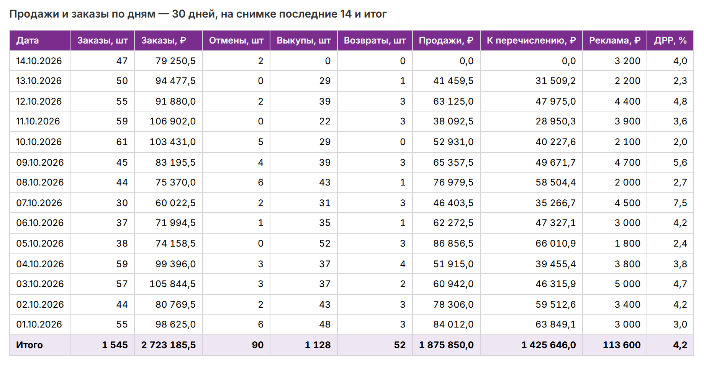
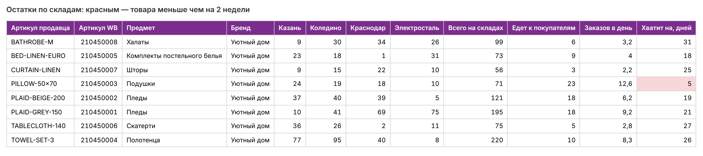
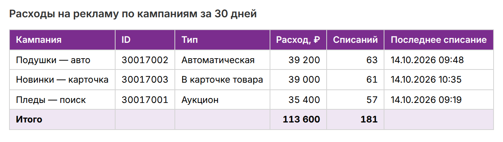
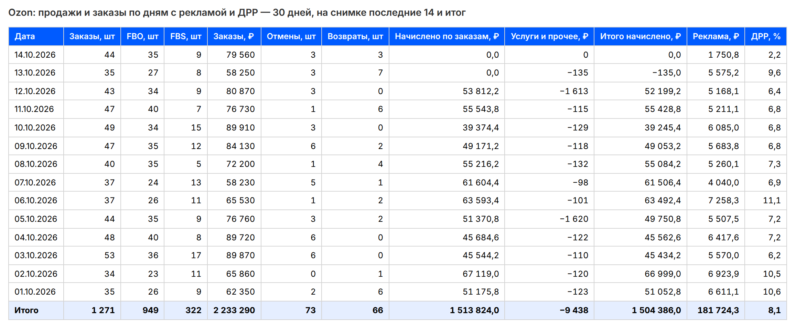
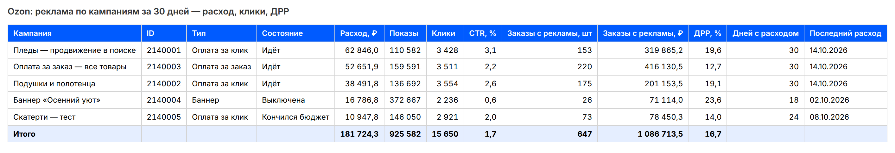

# Отчёт по магазину на Wildberries и Ozon — в Excel и Google Таблицу

Скрипт для продавца на WB и Ozon. На WB он раз в день (или как часто нужно)
сам забирает данные из кабинета через официальный API и собирает понятный
отчёт из трёх листов:

- **Продажи и заказы** — по дням: заказы в штуках и рублях, отмены, выкупы,
  возвраты, продажи, сумма к перечислению, расход на рекламу и ДРР (доля
  рекламы в заказах), внизу итог за период; заказы и ДРР считаются по всем
  заказам дня, включая отменённые, а отмены видны отдельным столбцом;
- **Остатки** — каждый артикул по складам WB, сколько едет к покупателям,
  сколько в среднем заказывают в день и на сколько дней хватит остатка;
  товар, которого меньше чем на две недели, подсвечен красным — пора везти
  поставку;
- **Реклама** — расходы по каждой кампании за период, сколько было списаний
  и когда последнее.

На Ozon — тот же отчёт по Seller API, а реклама — по Performance API:

- **Продажи и заказы** — по дням (московским, как в кабинете): заказы в
  штуках и рублях, отдельно FBO и FBS, отмены, возвраты, начисления Ozon по
  заказам, удержания за услуги и итог начислений; если подключена
  реклама — расход на неё за день и ДРР (доля рекламы в заказах);
- **Остатки** — каждый артикул по кластерам складов Ozon, свой склад (FBS),
  что едет на склады и возвращается от покупателей, заказов в день и на
  сколько дней хватит; меньше двух недель — подсвечено красным;
- **Реклама** — каждая кампания за период: тип и состояние, расход, показы,
  клики, CTR, заказы с рекламы в штуках и рублях, ДРР, сколько дней шёл
  расход и когда последний; кампании без показов и расхода не показываются;
- **Заказы и возвраты по товарам** — заказано, отменено, возвращено, доля
  возвратов и самая частая причина возврата по каждому артикулу.

Площадку выбирает флаг `--market ozon` или строка `MARKETPLACE=ozon` в
`.env`. Отчёт сохраняется в Excel и, если нужно, обновляется в Google
Таблице — её удобно открыть с телефона или дать менеджеру.

> Это демо: магазин «Уютный дом», товары, продажи и кампании выдуманы.

## Как выглядит







Ozon — продажи и заказы по дням с расходом на рекламу и ДРР:



Ozon — реклама по кампаниям:



Снимки — листы настоящего отчёта: тот же код построил его на выдуманном
магазине (как `--demo`), цвета взяты из файла Excel (`tools/render.py`).

## Как запустить

Нужен Python 3.11+.

```bash
python -m venv .venv
.venv/bin/pip install -r requirements.txt
.venv/bin/python -m wbreport --demo     # посмотреть на выдуманном магазине
cp .env.example .env                    # вписать токен WB
.venv/bin/python -m wbreport            # отчёт по своему кабинету → out/wb_report.xlsx

.venv/bin/python -m wbreport --market ozon --demo   # Ozon на выдуманном магазине
.venv/bin/python -m wbreport --market ozon          # свой кабинет Ozon → out/ozon_report.xlsx
```

- `WB_TOKEN` — токен из кабинета продавца: Настройки → Доступ к API,
  категории «Статистика», «Аналитика» и «Продвижение», режим «Только на
  чтение». Скрипт ничего не меняет в кабинете.
- `OZON_CLIENT_ID`, `OZON_API_KEY` — для Ozon: кабинет продавца → Настройки →
  Seller API, там же Client ID. Скрипт только читает: отправления, товары и
  остатки, аналитику, возвраты и начисления.
- `OZON_PERF_CLIENT_ID`, `OZON_PERF_CLIENT_SECRET` — реклама Ozon, это
  отдельный ключ, не Seller API: кабинет продавца → Настройки → API-ключи →
  Performance API, создать сервисный аккаунт, взять client_id и
  client_secret. Без них отчёт строится без рекламы — колонок и листа
  «Реклама» нет, а не нули.
- `MARKETPLACE` — `wb` (по умолчанию) или `ozon`; флаг `--market` важнее.
- `DAYS` — за сколько дней отчёт (по умолчанию 30), можно и флагом `--days 7`.
- `EXCEL_PATH` — куда сохранить Excel; по умолчанию `out/wb_report.xlsx` или
  `out/ozon_report.xlsx`, относительный путь — от папки проекта.
- `GSHEET_ID`, `GOOGLE_CREDENTIALS` — необязательно, Google Таблица: создать
  сервисный аккаунт в Google Cloud, скачать ключ JSON и указать путь,
  расшарить таблицу на почту аккаунта с правом редактирования, id взять из
  адреса таблицы.

По расписанию: `--every 360` — обновлять каждые 6 часов, сбой одного запуска
не останавливает следующие. Или строкой в cron:
`0 7 * * * cd /path/wb-report-demo && .venv/bin/python -m wbreport`.

## Как устроено

```
wbreport/
  api.py       клиент API WB: заказы, продажи, остатки, реклама
  report.py    сводка из ответов WB в три листа — без сети
  export.py    Excel (оформление, итоги, подсветка) и Google Таблица
  fake.py      выдуманный магазин и местный сервер с форматом ответов WB
  config.py    настройки из .env
  ozon_api.py     клиенты Ozon: Seller API (отправления FBO и FBS, остатки, возвраты,
                  начисления) и Performance API (токен, кампании, расход по дням)
  ozon_report.py  сводка из ответов Ozon в три-четыре листа — без сети
  ozon_fake.py    тот же магазин на Ozon, его реклама и местные серверы Seller и Performance API
  __main__.py  запуск, демо-режим, расписание
tests/         клиент на местном сервере, расчёты, выгрузка, запуск целиком
tools/         render.py и shoot.py — снимки листов для README
```

Лимиты WB учтены: заказы и продажи — не чаще раза в минуту, длинный ответ
дочитывается страницами без дублей, при «слишком часто» и сбоях WB скрипт
ждёт столько, сколько просит WB (но не дольше 5 минут), и повторяет — до 4
попыток. Остатки WB отдаёт отчётом, который готовится на его стороне, —
скрипт ждёт готовности до 5 минут. Расходы на рекламу WB отдаёт не больше
чем за 31 день — длинный период режется на куски.
Неверный токен — понятная ошибка «доступ запрещён, проверьте токен».

На Ozon — актуальные методы Seller API на осень 2026: отправления FBO
(`/v2/posting/fbo/list`) и FBS (`/v4/posting/fbs/list`), товары с остатками
своего склада (`/v4/product/info/stocks`), остатки по кластерам Ozon
(`/v1/analytics/stocks`), возвраты (`/v1/returns/list`, по дню прихода на
склад) и начисления за день (`/v1/finance/accrual/by-day` — замена
отключённого списка транзакций). Отправления FBO запрашиваются по неделям
(дальше смещения 20 000 Ozon не листает), начисления — по одному дню,
остальное дочитывается курсором или страницами
с учётом лимитов Ozon, при «слишком часто» и сбоях — пауза и повтор. Ozon
отдаёт время в UTC, отчёт переводит его в московские дни.

Реклама Ozon — Performance API (`api-performance.ozon.ru`): токен
по client_id и client_secret (`/api/client/token`, живёт 30 минут — скрипт
обновляет его сам за минуту до конца и после отказа), список кампаний
(`/api/client/campaign`) и расход по дням (`/api/client/statistics/daily/json`).
Ozon отдаёт суммы строками с запятой и не больше чем за 62 дня — длинный
период режется на куски. ДРР в листе продаж — расход дня к сумме заказов
дня, в листе рекламы — расход кампании к заказам, которые Ozon записал на неё.

## Проверки

- **Отчёт целиком** — на выдуманном магазине через местный сервер, который
  отвечает в формате API WB: листание, повторы при ошибках, ожидание отчёта
  об остатках, разрезка рекламы, суммы с возвратами, подсветка остатков.
- **Живой кабинет WB** — не проверялся: в демо нет настоящего токена.
- **Ozon** — проверено на тестах без подключения к кабинету: местный сервер
  отвечает по схеме Seller API, проверены листание, лимиты, повторы, разбор
  цен FBO и FBS, отмены и возвраты, московские дни, прогноз остатков.
- **Реклама Ozon** — проверено на тестах без подключения к кабинету: местный
  сервер отвечает по схеме Performance API, проверены токен и его продление,
  разрезка на 62 дня, повторы, суммы с запятой, ДРР, сверка листа с ответом.
- **Google Таблица** — проверена на тестах без подключения.

```bash
.venv/bin/pip install -r requirements-dev.txt
.venv/bin/pytest
.venv/bin/ruff check .
```

Пересобрать снимки: `.venv/bin/python tools/render.py`, затем
`.venv/bin/python tools/shoot.py` (нужен Playwright с Chromium:
`.venv/bin/pip install playwright && .venv/bin/playwright install chromium`).

## Что можно добавить под заказ

Себестоимость и чистая прибыль по артикулам,
юнит-экономика с комиссией и логистикой, отчёт в Telegram каждое утро,
несколько кабинетов в одной таблице.
